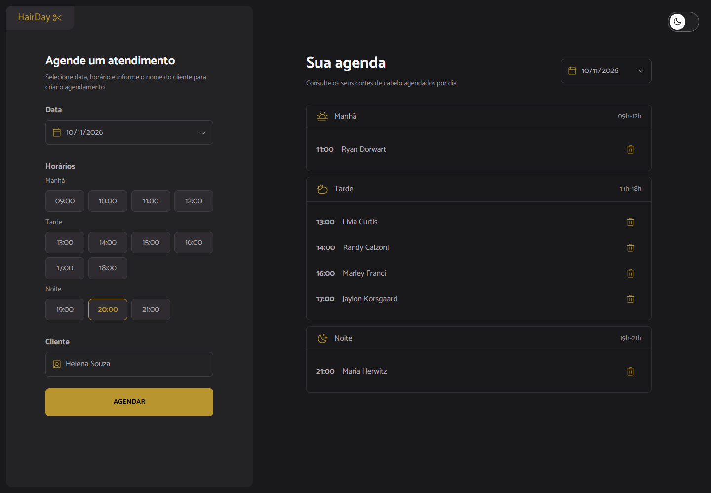
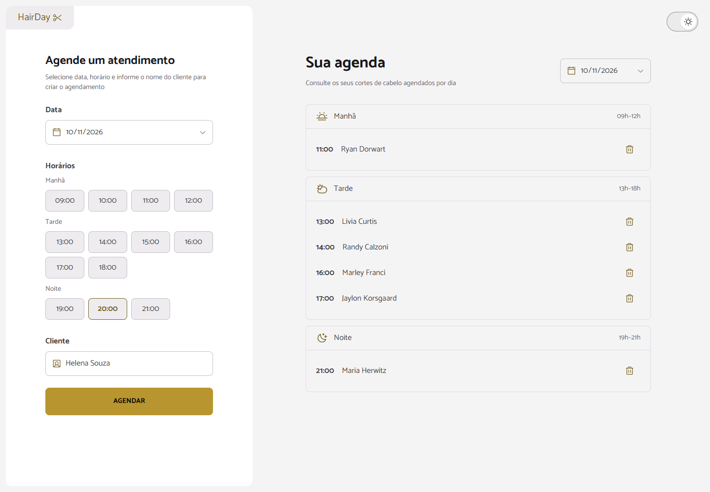
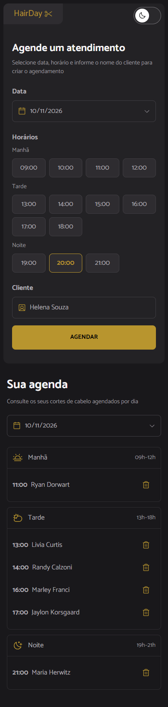
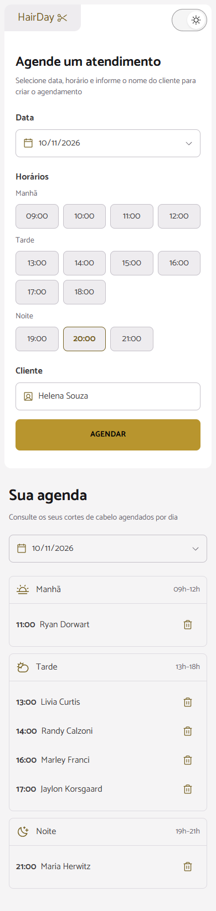

# Hair Day

Interface de agendamentos em React 19 e TypeScript, baseada no Figma do projeto.

**Repositório:** [github.com/vitorcgo/hair-day](https://github.com/vitorcgo/hair-day).

## Material da entrega

| Requisito | Arquivo ou endereço |
| --- | --- |
| Repositório GitHub | [vitorcgo/hair-day](https://github.com/vitorcgo/hair-day) |
| Documentação | Este README |
| Instruções do agente | [AGENTS.md](./AGENTS.md) |
| Capturas desktop e mobile | [Galeria de capturas](#capturas-de-tela) |
| Evidência do Context7 | [Consultas, retornos e aplicação no código](./docs/evidence/context7.md) |
| Evidência do Playwright | [Roteiro e resultados](./docs/evidence/playwright.md) |
| Deploy pelo GitHub Actions | [deploy.yml](./.github/workflows/deploy.yml) |

## Capturas de tela

As imagens são geradas pelo Playwright a partir do build de produção, com agendamentos fictícios inseridos pela interface. Elas não são montagens nem capturas do Figma.

### Desktop — 1440 × 1000 px

| Tema escuro | Tema claro |
| --- | --- |
|  |  |

### Mobile — viewport de 390 × 844 px

As capturas mobile incluem a página inteira, por isso a altura final é maior que a viewport.




## Executar

Use uma versão do Node compatível com as dependências instaladas (preferencialmente Node 22.13+ na linha 22 ou uma versão LTS mais recente).

```sh
npm install
npm run dev
```

No PowerShell, se `npm.ps1` for bloqueado pela política de execução, use `npm.cmd` no lugar de `npm`, sem alterar a política do sistema.

```sh
npm run lint
npm run build
npm run preview
```

O build também verifica os tipos com TypeScript. A configuração atual mantém Vite 7 e ESLint, com Tailwind CSS 4 integrado via `@tailwindcss/vite` e ícones Phosphor via `react-icons/pi`.

## Publicar no GitHub Pages

1. Envie o projeto para um repositório no GitHub, na branch `main`.
2. Em **Settings → Pages → Build and deployment → Source**, selecione **GitHub Actions**.
3. Faça push na `main` ou execute **Deploy Hair Day to GitHub Pages** pela aba **Actions → Run workflow**.
4. Após o workflow terminar, o endereço ficará disponível em **Settings → Pages** e na execução do deploy.

O arquivo `.github/workflows/deploy.yml` instala as dependências com `npm ci`, executa lint e build e publica a pasta `dist`. O workflow usa Node 24. Não é necessário criar uma branch `gh-pages` ou enviar a pasta `dist` manualmente.

O Vite usa `base: './'` para gerar URLs relativas, permitindo publicar em um subcaminho sem fixar o nome do repositório.

## Funcionalidades

- Cadastro com nome, data e um dos 13 horários definidos no design.
- Validação dos campos obrigatórios e de nomes contendo apenas espaços.
- Consulta por data, ordenação cronológica e agrupamento por manhã, tarde e noite.
- Exclusão individual e estado vazio por período.
- Layout empilhado no celular e em duas colunas a partir de 768 px, com espaçamentos adaptáveis.
- Temas claro e escuro: o botão no canto superior direito alterna a aparência. O tema inicial segue a preferência do sistema; a seleção não é persistida.

Os dados ficam somente no estado React: recarregar a página apaga os agendamentos. A data do cadastro e a data da consulta são independentes. Para consultar um cadastro de outro dia, selecione esse dia na agenda. Não há bloqueio de datas passadas ou horários duplicados.

## Organização

- `src/App.tsx`: estado compartilhado e ações de criação e exclusão.
- `src/components/`: sidebar, formulário, seletor de data, lista, períodos e itens.
- `src/data/periods.ts`: períodos, ícones e horários disponíveis.
- `src/types/appointment.ts`: contratos dos agendamentos.
- `src/utils/date.ts`: manipulação de datas locais, sem conversão para UTC.
- `src/hooks/useTheme.ts`: estado do tema e sincronização com a página usando `useEffect`.
- `src/index.css`: tokens de cores e tipografia do design system, estilos base e estados dos controles.

A fonte Catamaran é carregada pelo Google Fonts e precisa de conexão para o primeiro carregamento.

## Testes automatizados e geração de evidências

Após instalar as dependências:

```sh
npx playwright install chromium
npm run test:e2e
npm run test:evidence
npm run test:report
```

Os testes fazem um novo build, iniciam um servidor exclusivo na porta 4180 e validam os fluxos em Chromium, com projetos desktop e mobile. Ao final:

- `docs/screenshots/`: quatro capturas da aplicação, nos dois temas.
- `test-results/results.json`: relatório bruto do Playwright, ignorado pelo Git.
- `playwright-report/`: relatório HTML local, ignorado pelo Git.
- `docs/evidence/playwright-results.json`: resumo reproduzível do relatório bruto, gerado por `npm run test:evidence` e incluído na entrega.

Para aproveitar um Chrome já instalado no Windows, sem baixar Chromium:

```powershell
$env:PLAYWRIGHT_CHANNEL = 'chrome'
npm.cmd run test:e2e
npm.cmd run test:evidence
```

A emulação mobile usa Chromium com viewport e toque; não substitui um teste em aparelho físico. As capturas documentam o resultado, mas não são testes de regressão visual contra o Figma.

## Roteiro de teste manual

1. Envie o formulário vazio e confira as mensagens; tente também um nome com apenas espaços.
2. Cadastre horários fora de ordem nos três períodos e confira a ordenação.
3. Teste os limites: 09:00, 12:00, 13:00, 18:00, 19:00 e 21:00.
4. Mude a data da agenda e confirme que os agendamentos de outros dias não aparecem.
5. Volte à data original e exclua um agendamento; os demais devem permanecer.
6. Exclua todos os itens de um período e confira a mensagem de estado vazio.
7. Navegue por teclado: Tab para os controles, setas para os horários e Enter para enviar o formulário.
8. Confira o layout em desktop e mobile, incluindo nomes longos e mensagens de validação.
9. Alterne os temas e confira campos, horários selecionados, erros e lista. A troca não deve apagar o formulário ou os agendamentos.

Referência: [Figma — Hair Day](https://www.figma.com/design/nJzcBu8mLp89Mpy47Udr0T/?node-id=3-376).
